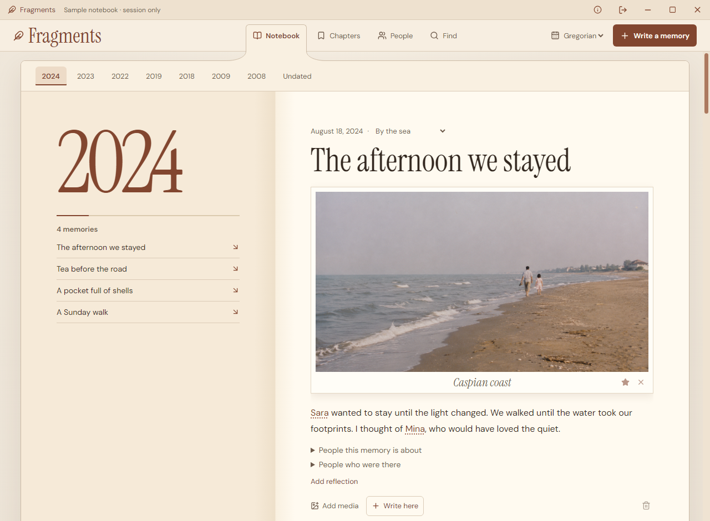
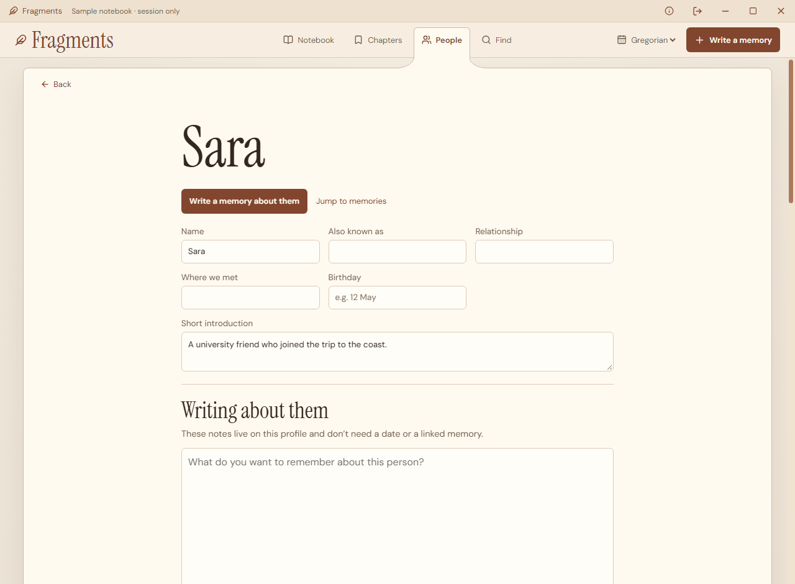
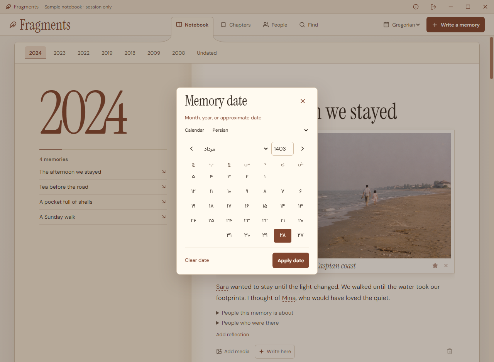

# Fragments

## 1. What is Fragments?

Fragments is a private journal for Windows. Use it to keep the stories, photos, videos, and people you want to remember in one place. The notebook is organized by year, and you can group related memories into chapters such as a trip, a school year, or time spent in a particular place.

**[Download the Windows x64 installer](https://github.com/AMIRSRAD/Fragments/releases/latest)**. Open Fragments from the Start menu. Choose **Open the sample notebook** to explore with fictional entries, or create a private notebook with a password of at least 12 characters. Changes to the sample notebook last for the session.

### What you can do

- **Write a memory.** Add a story, photos, or videos. Edit entries in place or add a dated reflection to record how you see an older memory now.
- **Use the dates you know.** Choose the Gregorian or Persian calendar. Enter an exact day, a month and year, an approximate year or season, or a date range. You can also leave a memory undated.
- **Keep a history with each person.** Write undated notes on a profile or group shared memories into phases you name. A memory written from a profile also appears in the Notebook. You can record who was there and who a story is about.
- **Find an older entry.** Search the writing and captions, or filter by person, chapter, year, and whether a memory has photos.
- **Back up or share selected memories.** A private notebook saves encrypted data on your device. Export an encrypted backup to keep a separate copy. An HTML album is a readable, unencrypted file that can be opened without Fragments.
- **Share an original photo or video.** Use the download icon on an attachment in a private notebook to save an unencrypted copy. This also works for large videos that exceed the HTML album’s size limit. Video preview depends on the codecs available in Windows WebView2.

### Screenshots

These screenshots use the fictional sample notebook.



*Notebook · Browse by year and read or edit memories in place.*



*People · Keep profile notes alongside a shared memory timeline.*



*Memory date · Choose a day in the Persian calendar or use a less precise date.*

## 2. Technical details

| Area | Implementation |
| --- | --- |
| Interface | React and TypeScript, bundled with Vite. The desktop shell uses Tauri 2 and Windows WebView2. |
| Notebook storage | The Rust backend uses age-encrypted JSON snapshots. The notebook password protects the archive key, and the backend retains the previous committed snapshot for recovery. |
| Media | Originals are stored as separate encrypted files. Imports, encrypted backups, and restores stream attachment bytes. Video playback uses byte-range reads, with format support provided by WebView2. |
| Backup and export | A `.fragments` backup is a tar bundle containing an encrypted snapshot and its referenced media. HTML albums are unencrypted and limit embedded attachments to 64 MiB after encoding. |
| Updates | About checks GitHub Releases. When an update is available, the user can open the release and install it manually. |

The frontend lives in [app/src](app/src), the native backend in [app/src-tauri/src](app/src-tauri/src), and desktop packaging settings in [tauri.conf.json](app/src-tauri/tauri.conf.json). Full backup and restore at 400 GB has not been verified.

For more detail, see the [desktop guide](app/README.md), [technical architecture](TECHNICAL_ARCHITECTURE.md), [archive format](ARCHIVE_FORMAT.md), and [privacy and recovery plan](PRIVACY_AND_RECOVERY.md). The [product plan](PRODUCT_PLAN.md), [decisions](DECISIONS.md), [UI design](UI_DESIGN.md), [user journeys](USER_JOURNEYS.md), [implementation plan](IMPLEMENTATION_PLAN.md), and [next steps](NEXT_STEPS.md) also describe planned work.

## 3. Build from source

On Windows, install Git, Node.js, Rust with the MSVC toolchain, Microsoft C++ Build Tools with the **Desktop development with C++** workload, and the WebView2 runtime. The build was verified with Node.js 22.19.0 and Rust 1.95.0. See the [Tauri Windows setup guide](https://v2.tauri.app/start/prerequisites/#windows).

Open PowerShell and run:

```powershell
git clone https://github.com/AMIRSRAD/Fragments.git
cd Fragments/app
npm ci
npm run build:installer
```

The installer is generated under `app/src-tauri/target/release/bundle/nsis/` from the repository root.

| Command from `app/` | Purpose |
| --- | --- |
| `npm run tauri -- dev` | Run the Windows desktop app while developing. |
| `npm run dev` | Open the sample notebook in a browser using the address printed by Vite. |
| `npm run build:desktop` | Build a standalone debug executable at `src-tauri/target/debug/Fragments.exe`. |
| `npm run build` | Type-check and build the frontend. |
| `cargo test --manifest-path src-tauri/Cargo.toml --lib` | Run the Rust archive and media tests. |

Close the browser development server before starting Tauri development. Both use port 1420.
